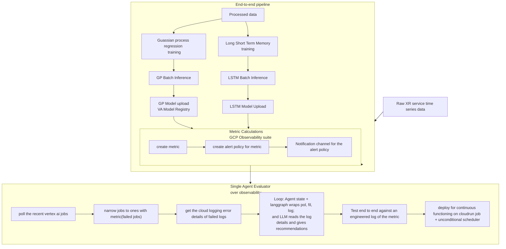

# END TO END MLOps PIPELINE WITH AGENTIC MONITOR
[Architecture Diagram](../LSTM%20GP%20UE%20EE/diagrams/end%20to%20end%20mlops%20pipeline.png)

## Brief Description
### Introduction: Objective, Definitions, Scope
This is the implementation of the full MLOps pipeline from data ingestion to model monitoring. Its a cloud platform implementation of [a project in my PhD](https://www.researchgate.net/publication/385682682_Prediction-based_Discontinuous_Reception_Mechanism_for_Extended_Reality_Applications). Its conceptual objective is to improve energy efficiency (EE) on extended reality (XR) devices using Long Short Term Memory (LSTM) and Gaussian Process (GP) regression models.  

This google cloud platform (GCP) implementation covers data management( ingestion, preprocessing, drift and skew monitoring), model training, batch inference and model monitoring. It also layers a pipeline evaluatory monitoring agent to demonstrate agentic workflow. 
### Components
1. data ingestion and preprocessing: using storage buckets 
2. LSTM and GP training: using Vertex AI (VA) pipelines and training 
3. model upload (to VA model registry) 
4. batch inference: using Bigquery 
### Results
The results of the original work is the comparison of the ML based algorithms to the 3GPP standard for XR device energy efficiency. This covers the metric results of the two algorithms, and the EE-delay tradeoff of the algorithms on the devices compared with the standards  

For the cloud implementation, the results are a combination of the metric results of the two algorithms (i.e. the root mean square error (RMSE)) and GCP observability workflows implemented. 

For the GCP observability, 4 metrics and corresponding alert policies were implemented, namely: 
1. pipeline latency 
2. pipeline failure 
3. prediction drift 
4. row count anomaly (in batch inference) 

Lastly, an agentic workflow was implemented for the pipeline failure metric for demonstration. 

### Agentic Workflow
1. polling: Create the desired functionality for the metric to be polled. 
2. filtering: Write the cloud logging filter for that metric. 
3. ``Langgraph`` agent state looping (of polling and filtering) 
3. test end to end  
4. deploy on server (``cloudrun job + cloud scheduler``) for continuous polling 

# INFRASTRUCTURE ARCHITECTURE DETAILS
## APIs
1. AI platform ``aiplatform.googleapis.com``  
2. Bigquery ``bigquery.googleapis.com``  
3. BigQuery Storage ``bigquerystorage.googleapis.com``  
4. CloudBuild ``cloudbuild.googleapis.com``  
5. Cloud Scheduler ``cloudscheduler.googleapis.com``  
6. Compute ``compute.googleapis.com``  
7. IAM ``iam.googleapis.com``  
8. Cloud Resource Manager ``cloudresourcemanager.googleapis.com`` 
9. Storage ``storage.googleapis.com``  
10. Artifact Registry ``artifactregistry.googleapis.com``  
## BigQuery
1. One ``google_bigquery_dataset`` called ``xr_predictions``  
2. Two ``google_bigquery_table``s: 
  - ``lstm_predictions`` 
  - ``gp_predictions``  
## IAM
1. Set up a service account for the workflow pipeline ``pipeline_sa`` 
2. ``pipeline_sa`` is granted the following roles and access levels under ``google_project_iam_member`` 
  - ``roles/aiplatform.user``  
  - ``roles/bigquery.dataEditor``  
  - ``roles/bigquery.jobUser``  
  - ``roles/logging.logWriter``  
  - ``roles/storage.admin``   
3. ``pipeline_sa`` set to self impersonate under ``google_service_account_iam_member`` with roles
  - ``roles/iam.serviceAccountUser``  
  - ``roles/iam.serviceAccountUser``  
4. cloudbuild service account is granted roles 
  -``cloudbuild_sa_storage`` is granted  ``roles/storage.admin``   
  - ``cloudbuild_sa_vertex`` is granted ``roles/aiplatform.user``  
## Storage
1. 5 storage buckets are used in this project:
  - ``lstm-gp-xr-ue-ee-terraform-state`` for storing Terraform state  
  - ``raw-data`` bucket  
  - ``model artefact`` bucket  
  - ``pipeline_root`` bucket  
  - ``processed_data`` bucket  
## Operations
### CI/CD
1. Pipeline deployement automations are defined in ``cloudbuild.yaml``  
  - Dependencies installation, compilation and submition of ``xr_mlops_pipeline`` to Vertex AI pipeline via ``run_pipeline``  
  - Pipeline yaml (compile pipeline) is uploaded to GCS bucket ``pipeline_root``  
  - Cloud Logging is enabled  
2. Git triggered build are set against the project repository.  
### Observability: Monitoring, Alerts, Notification Channels
1. Cloud Logging is enabled for pipeline workflow  
2. Custom metrics are defined with alerts and notigication channels  
  - Pipeline latency  
  - Pipeline failure  
  - Prediction Drift  
  - Row count anomalies during batch prediction  
### Agentic Monitor
1. polling: Create the desired functionality for the metric to be polled. 
2. filtering: Write the cloud logging filter for that metric. 
3. ``Langgraph`` agent state looping (of polling and filtering) 
3. test end to end  
4. deploy on server (``cloudrun job + cloud scheduler``) for continuous polling 
## Pipeline
1. Data Preprocessing  
2. Parallel training LSTM and GP  
3. Evaluate: RMSE for both models  
4. Model Upload: of both models in VA model registry  
5. Batch Inference in Bigquery  
